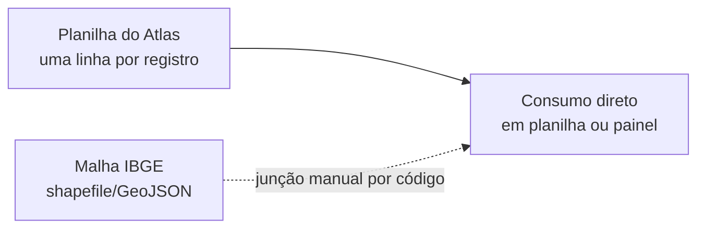
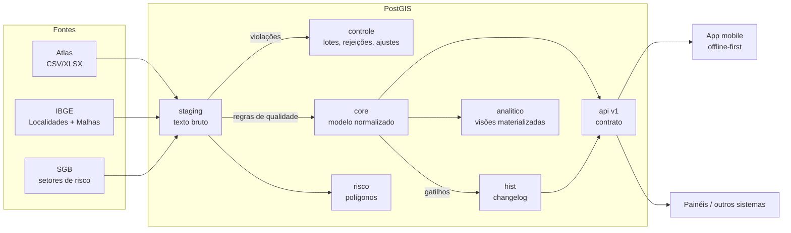

# 02 - Baseline de arquitetura de dados (as-is / to-be)

## Contexto

O projeto parte de uma situação comum em sistemas públicos legados: os dados existem e têm valor, mas chegam como **planilha desnormalizada**, com formatos inconsistentes, sem chaves garantidas e sem histórico. O arquivo do Atlas Digital de Desastres faz aqui o papel do "as-is". O banco PostGIS proposto é o "to-be".

## As-is

| Dimensão | Situação observada |
|---|---|
| Estrutura | Uma tabela larga: município, tipologia, datas e dezenas de colunas de dano na mesma linha |
| Chaves | Protocolo nem sempre presente; código de município às vezes truncado (6 dígitos) |
| Tipos | Tudo texto na prática: datas em vários formatos, números com separador brasileiro |
| Integridade | Nenhuma garantia de que o município existe, de que o COBRADE é válido ou de que datas fazem sentido |
| Geografia | Dissociada: depende de junção manual com a malha, sem validação de geometria |
| Histórico | Cada nova versão do arquivo substitui a anterior; não se sabe o que mudou |
| Rastreabilidade | Não há como apontar de qual arquivo e linha veio um número |
| Integração | Cada consumidor interpreta o arquivo à sua maneira |

## To-be

| Dimensão | Decisão to-be | Referência |
|---|---|---|
| Estrutura | Modelo normalizado: território, COBRADE, ocorrência e danos em tabelas próprias | [03](03-modelo-conceitual.md), [04](04-modelos-logico-e-fisico.md) |
| Chaves | Chave natural estável (protocolo ou hash determinístico) + chave substituta interna | ADR-0006 |
| Tipos | Tipagem forte no core; staging aceita tudo como texto para não perder linhas | ADR-0002 |
| Integridade | No banco, não só na aplicação: FKs, CHECKs, FK composta para COBRADE folha, gatilho de unidade | [06](06-regras-de-integridade.md) |
| Geografia | SIRGAS 2000 (4674), geometrias validadas e corrigidas, índices GiST | ADR-0003 |
| Histórico | Changelog por gatilho, consulta "as-of", versão por registro | ADR-0007 |
| Rastreabilidade | Toda linha do core aponta para lote e linha de origem; rejeições e ajustes registrados | [06](06-regras-de-integridade.md) |
| Integração | Schema `api` versionado, GeoJSON e sincronização incremental | ADR-0008, [08](08-mapa-de-dados-e-integracoes.md) |
| Evolução | Migrações versionadas, testes automáticos e CI | ADR-0009 |

## Lacunas entre as-is e to-be e como cada uma foi tratada

| # | Lacuna | Tratamento |
|---|---|---|
| L1 | Formatos de data e número heterogêneos | Funções de normalização puras e testadas (`staging.fn_parse_*`) |
| L2 | Registros sem protocolo | Chave por hash de município + COBRADE + data (ADR-0006) |
| L3 | Código de município com 6 dígitos | Completado quando o prefixo é único, com registro em `controle.ajuste` |
| L4 | Linhas inválidas | Quarentena em `controle.rejeicao` com regra e registro original; o lote não falha por causa delas |
| L5 | Danos em colunas largas | Modelo longo com catálogo de indicadores (ADR-0005) |
| L6 | Nova versão do arquivo apaga a anterior | Upsert idempotente + changelog: só gera versão o que realmente mudou |
| L7 | Geometrias inválidas | `ST_MakeValid` na promoção e CHECK `ST_IsValid` no core |
