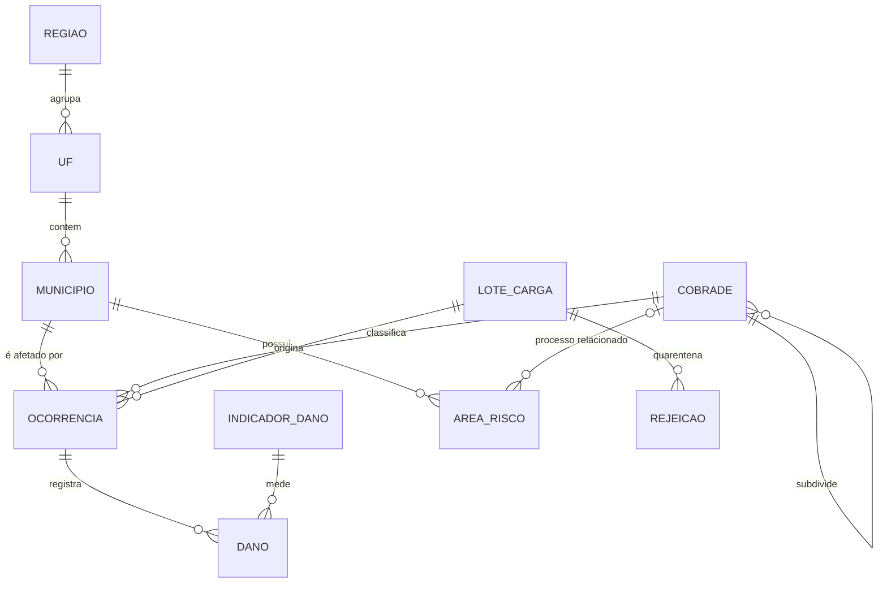

# 03 - Modelo conceitual

Independente de tecnologia. Descreve as entidades do domínio de proteção e defesa civil tratadas aqui e como se relacionam.

## Entidades

| Entidade | Definição | Identificação |
|---|---|---|
| Região | Grande região geográfica do IBGE | Sigla (N, NE, SE, S, CO) |
| UF | Unidade da Federação | Código IBGE de 2 dígitos |
| Município | Unidade político-administrativa onde o desastre é registrado | Código IBGE de 7 dígitos |
| COBRADE | Nó da classificação brasileira de desastres (categoria > grupo > subgrupo > tipo > subtipo) | Código de 5 dígitos |
| Ocorrência | Registro de um desastre em um município, em uma data, com uma tipologia | Protocolo S2iD ou chave derivada |
| Indicador de dano | Tipo de dano ou prejuízo mensurado (óbitos, desabrigados, prejuízo público...) | Código do indicador |
| Dano | Valor de um indicador para uma ocorrência | Ocorrência + indicador |
| Área de risco | Polígono mapeado com grau de risco para um processo | Fonte + identificador externo |
| Lote de carga | Arquivo recebido de uma fonte | Fonte + hash do conteúdo |
| Rejeição | Registro de uma linha recusada, com o motivo | Lote + linha + regra |

## Regras de negócio que moldam o modelo

1. **Uma ocorrência pertence a exatamente um município.** Desastres que atingem vários municípios geram uma ocorrência por município (como no S2iD). A visão regional é reconstruída por vizinhança espacial e proximidade temporal ([09](09-consultas-espaciais.md)).
2. **Só nós-folha da COBRADE classificam ocorrências.** "Hidrológico" é um grupo; a ocorrência é "Inundações" ou "Enxurradas".
3. **Dano não informado é diferente de dano zero.** Ausência de linha = não informado; valor 0 = informado como zero.
4. **Totais são derivados, nunca armazenados.** "Pessoas diretamente afetadas" é calculado a partir dos indicadores marcados no catálogo.
5. **Toda informação tem origem.** Não existe ocorrência sem lote e linha de origem.
6. **Nada é sobrescrito sem rastro.** Alterações geram nova versão e evento de histórico.
