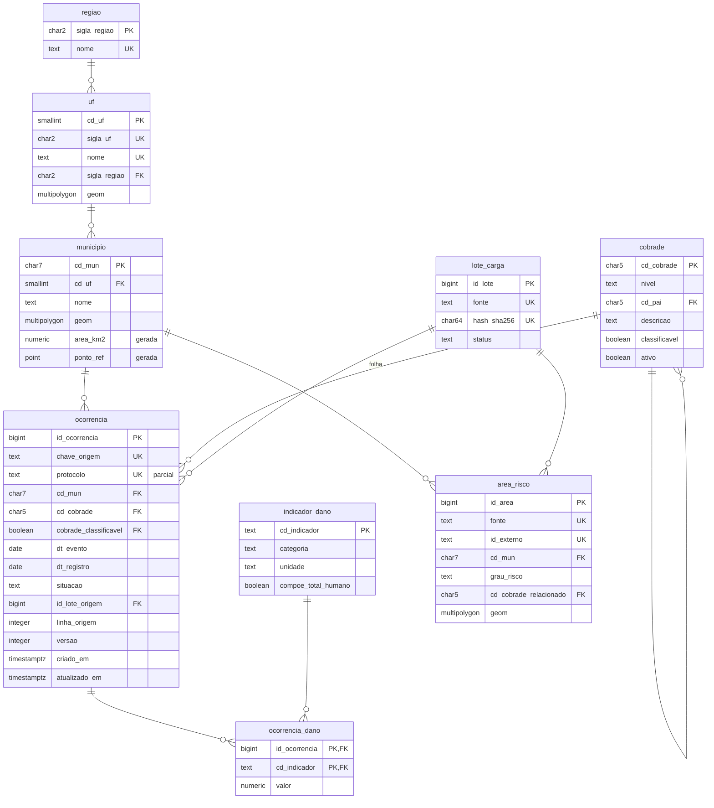

# 04 - Modelos lógico e físico

## Modelo lógico (núcleo)

Estruturas de apoio (staging, histórico, rejeições, ajustes) estão no [dicionário de dados](05-dicionario-de-dados.md).

## Decisões do modelo físico

| Tema | Decisão | Motivo |
|---|---|---|
| Tipos de código | `char(7)` / `char(5)` com CHECK de regex, não inteiro | Códigos são identificadores, não quantidades; preserva zeros à esquerda e impede aritmética sem sentido |
| Chave da ocorrência | `bigint identity` interno + `chave_origem` única | Chave substituta estável para FKs; chave natural para idempotência e para o contrato público (ADR-0006) |
| COBRADE folha | FK composta `(cd_cobrade, cobrade_classificavel)` -> `cobrade (cd_cobrade, classificavel)` com a coluna fixa em `true` | Garante no banco, sem gatilho, que só folhas classificam (ADR-0004) |
| Coerência município x UF | CHECK `substr(cd_mun,1,2) = cd_uf` | O código IBGE carrega a UF; a redundância é verificada, não confiada |
| Colunas derivadas | `area_km2` e `ponto_ref` como `GENERATED ALWAYS ... STORED` | Calculadas uma vez, nunca divergem da geometria |
| `ponto_ref` | `ST_PointOnSurface`, não `ST_Centroid` | Centroide pode cair fora de municípios côncavos ou com ilhas; o ponto na superfície é sempre interno |
| Distâncias | Índice GiST de expressão em `ponto_ref::geography` | Raio em metros com precisão geodésica e uso de índice ([07](07-desempenho.md)) |
| Danos | Tabela longa `ocorrencia_dano` + catálogo `indicador_dano` | Novos indicadores sem alterar estrutura; unidade e categoria explícitas (ADR-0005) |
| Valores | `numeric(18,2)` com CHECK `>= 0` + gatilho de inteiro para PESSOAS/UNIDADES | Monetário exato; contagem de pessoas não pode ser fracionada |
| Datas | `date` para evento e registro; `timestamptz` para metadados | Eventos são datas civis; metadados precisam de instante absoluto |
| Particionamento | Não adotado | Volume esperado (centenas de milhares de linhas) não justifica; reavaliar acima de dezenas de milhões (risco RT-07) |

## Índices

| Índice | Tipo | Consulta atendida |
|---|---|---|
| `ix_ocorrencia_cobrade_data (cd_cobrade, dt_evento)` | B-tree | Filtro por tipologia/grupo e período |
| `ix_ocorrencia_mun_data (cd_mun, dt_evento)` | B-tree | Histórico de um município; FK |
| `ix_ocorrencia_atualizado (atualizado_em)` | B-tree | Alterações recentes |
| `uq_ocorrencia_protocolo` | B-tree único parcial (`WHERE protocolo IS NOT NULL`) | Unicidade do protocolo sem penalizar nulos |
| `gx_municipio_geom` | GiST | Vizinhança, interseção, caixa espacial |
| `gx_municipio_ponto_geog ((ponto_ref::geography))` | GiST de expressão | Busca por raio em metros |
| `gx_area_risco_geom` | GiST | Interseção setor x município/ocorrência |
| Índices de FK | B-tree | Todo FK tem índice (verificado pelo teste 010) |

Os ganhos medidos estão em [07 - Desempenho](07-desempenho.md).
