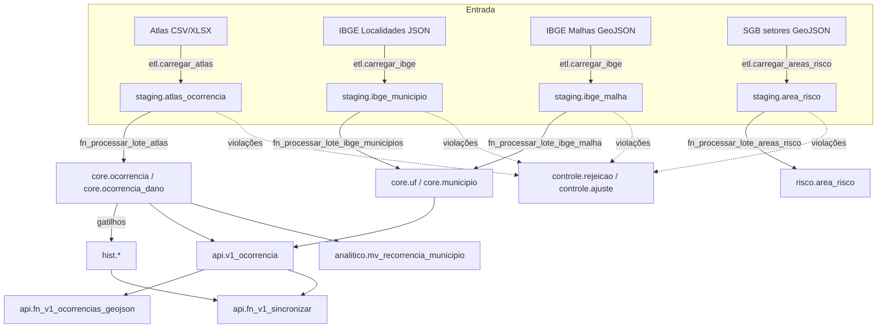
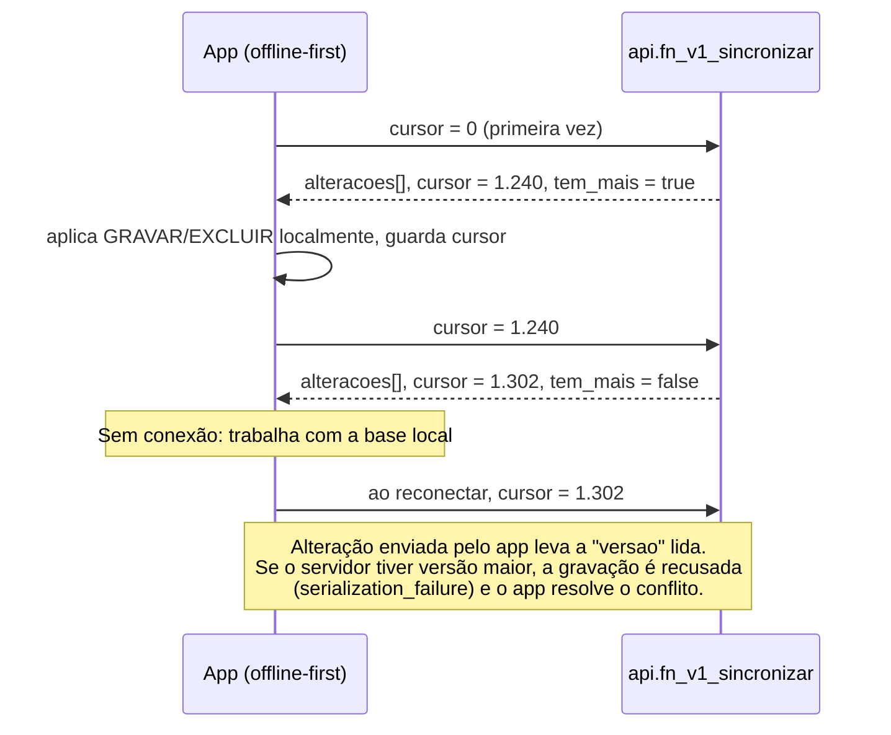

# 08 - Mapa de dados e integrações

## Fluxo de dados

**Ordem obrigatória de carga:** território (cadastro, depois malhas) -> ocorrências -> áreas de risco. Ocorrências e setores dependem do município existir.

## Mapa de dados por campo (Atlas -> core -> contrato)

| Arquivo (normalizado) | Staging | Core | API v1 | Transformação |
|---|---|---|---|---|
| `protocolo` | `protocolo` | `protocolo`, `chave_origem` | `protocolo`, `id` | Maiúsculas; ausente -> chave por hash |
| `uf` | `uf` | (validação apenas) | `uf` (do cadastro) | Conferida contra o município (R03) |
| `cod_ibge_mun` | `cd_mun` | `cd_mun` | `cd_mun` | Só dígitos; 6 dígitos completado (A01) |
| `nome_municipio` | `nome_mun` | (não gravado) | `municipio` (do cadastro) | Cadastro IBGE é a fonte do nome |
| `data_evento` | `dt_evento` | `dt_evento` | `dt_evento` | ISO, dd/mm/aaaa ou série Excel |
| `data_registro` | `dt_registro` | `dt_registro` | `dt_registro` | Idem |
| `cod_cobrade` | `cobrade` | `cd_cobrade` | `cd_cobrade`, `tipologia`, `grupo_cobrade` | Extrai 5 dígitos; descrição vem da árvore |
| `status` | `situacao` | `situacao` | `situacao` | Texto aparado (domínio pendente, P-02) |
| `dh_*`, `dm_*`, `pepl_*`, `pepr_*` | `danos` (jsonb) | `ocorrencia_dano` | `danos`, `total_pessoas_afetadas` | Número pt-BR/en-US; total calculado |
| demais colunas | `extras` (jsonb) | - | - | Preservadas para análise futura |
| - | - | `ponto_ref` (município) | `longitude`, `latitude`, geometria GeoJSON | `ST_PointOnSurface` da malha |

## Contrato de integração v1

Único ponto de acesso para consumidores externos. Papel de banco `s2id_consumidor` só enxerga o schema `api` (verificado no teste 060).

| Interface | Uso | Esquema |
|---|---|---|
| `api.v1_ocorrencia` (visão) | Consulta tabular, painéis, outros sistemas | [`contracts/ocorrencia.v1.schema.json`](../contracts/ocorrencia.v1.schema.json) |
| `api.fn_v1_ocorrencias_geojson(bbox, desde, cobrade, limite)` | Mapas: FeatureCollection filtrada por caixa, data e prefixo COBRADE | Feições cujas `properties` seguem o esquema da ocorrência |
| `api.fn_v1_sincronizar(cursor, limite)` | Clientes offline-first: alterações desde o último cursor | [`contracts/sincronizacao.v1.schema.json`](../contracts/sincronizacao.v1.schema.json) |

Exemplo de página de sincronização: [`evidencias/exemplo_sincronizacao.txt`](evidencias/exemplo_sincronizacao.txt).

### Regras de evolução do contrato

- Na v1 só se **acrescentam** campos opcionais. Consumidores devem ignorar campos desconhecidos (`additionalProperties: true`).
- Remover, renomear ou mudar tipo de campo cria `api.v2_*` ao lado da v1, com prazo de convivência combinado.
- O identificador público é `chave_origem`; a chave substituta interna nunca é exposta, para que reprocessamentos não mudem identificadores.
- `tests/validar_contrato.py` valida as respostas reais do banco contra os esquemas a cada execução da CI: uma migração que quebre o contrato falha antes de chegar ao consumidor.

### Protocolo de sincronização para o app offline-first

